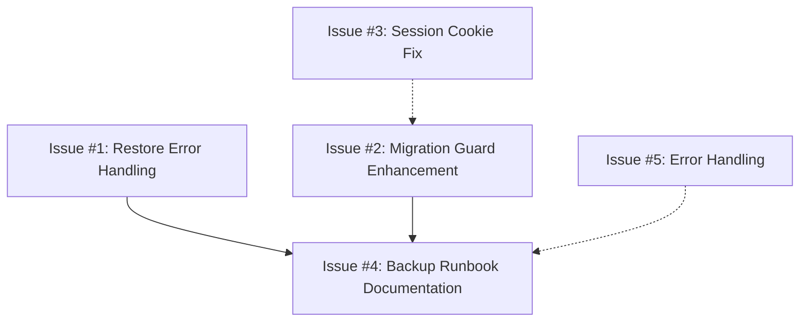

# Cafe POS — Project Status and Technical Roadmap

**Status basis:** Current repository source, the existing consolidated audit, and targeted implementation/build/smoke checks
**Last reviewed:** 2026-11-01
**Review type:** Source review and Windows desktop release-preparation work. First-run setup, invalid-credential rejection, login, and session persistence were verified against packaged local services in Chromium; final installer and other release acceptance checks remain outstanding.

> Read this document before beginning a new project task. Verify relevant details against current source before editing; this is a continuity aid, not a substitute for source review.

## Project overview

Cafe POS is a local, single-cashier point-of-sale application intended to run on one computer. It is not a SaaS, cloud, multi-branch, multi-tenant, or distributed product. The stack is deliberately local and should remain simple unless the user changes the scope.

### Architecture

- **Client:** Next.js App Router, React, and strict TypeScript; Tailwind CSS and shadcn/Radix UI.
- **API:** Node.js, Express, TypeScript, Zod request validation, cookie-based JWT authentication, bcryptjs PIN hashing, Helmet, and CORS.
- **Database:** SQLite in a local file, accessed through Prisma 7 and the `better-sqlite3` adapter.
- **Client state/data:** Zustand stores the cart and older locally persisted receipts; TanStack Query manages API queries and mutations; Axios is used by client services.
- **Desktop:** Electron now has a Windows NSIS packaging path that bundles a Node runtime, starts the packaged Next.js client and Express API on loopback, and stores the database, product photos, and generated JWT secret under the app's per-user data directory. An isolated Chromium test against these packaged local services verified setup, login, rejected credentials, and session persistence after refresh. Final installer and Windows installation acceptance remain incomplete.
- **API boundaries:** Browser requests go through HTTP and the Next.js proxy to Express. Client code must not access Prisma or SQLite directly.
- **Server organization:** Routes → controllers → services → Prisma. Prisma schema is split across `server/prisma/schema/`, with migration history under `server/prisma/migrations/`.

Treat the current source and this status document as the implementation references. Older supporting docs are absent from the current worktree; verify behavior against source rather than relying on prior summaries.

## Completed and currently implemented features

The following are supported by current source; test and browser evidence is dated in the Testing status section. This is implementation status, not proof of production readiness.

- Catalog search and category filters now work against the loaded menu; unavailable products are visible but disabled by default, and can be hidden from the grid.
- Product-list query parameters are Zod-validated; repeated/invalid filters return a 400 instead of reaching the service as malformed values. The API hides unavailable products unless explicitly asked to include them.
- Product and category management is available at `/products`. Authenticated API operations create/update products, change checkout availability, and create/rename/delete categories. Existing category strings are backfilled to a category registry by an additive migration; category renames update assigned products transactionally, and category deletion is rejected while products remain assigned. Products are retained rather than hard-deleted so order snapshots and references remain intact.
- Product management accepts optional JPG, PNG, and WebP photos up to 5 MB. Files are stored locally under `server/data/product-images`; products keep a relative API path, and the checkout catalog renders the photo or its existing placeholder. Upload, replacement, and removal are authenticated. This filesystem storage is separate from the SQLite database and must be included in any future backup workflow. This change has not been browser- or build-verified.
- Expense tracking is available at `/expenses`. Authenticated staff can record a purchase description, category, amount in integer paisa, date/time, and optional note. The page calculates totals/counts across all matching date/category/search filters and shows a cursor-paginated shadcn Table history, displaying 10 entries at a time with previous/next navigation. Search matches descriptions and notes. Expense records are audit-logged and are not currently editable or deletable.
- Menu management uses the existing shadcn Button, Card, Field, Input, Select, Table, Badge, and official Textarea primitives. Its searchable, filterable, 10-row paginated product table shows local photos, category, price, availability, and edit/toggle actions; it exposes validation/API errors, loading states, and category assignment.
- Product prices and server order/payment amounts use integer paisa. The API returns `pricePaisa`; display formatting occurs in the client.
- Staff list, PIN login, current-session lookup, cookie logout, and authenticated route gating are implemented. The login form now binds its visible default staff choice to the submitted ID; wrong credentials remain rejected, and the browser session survives a reload.
- Client UUID generation uses Web Crypto `getRandomValues` to remain available when this local app is opened over a LAN HTTP address, where `crypto.randomUUID()` is unavailable. The same UUID-v4 helper is used for order, payment, and cashier-session idempotency keys.
- Protected staff and menu-management routes require an active authenticated staff member. Role-based permissions are intentionally out of scope while cashier permissions are equal.
- Login uses four masked shadcn OTP slots for the required numeric PIN. Sign-in remains disabled until all four digits are entered and while a request is pending; changing staff clears the prior PIN and error. The login card was refined for hierarchy and narrow-screen fit. These UI states and invalid-credential feedback were checked in-browser; successful authentication behavior was verified in the prior production-browser pass.
- Cashier register sessions support opening, current/history lookup, and closing; checkout requires an open session and closing is blocked while unpaid orders remain.
- New checkout sends product IDs, quantities, order type, and an idempotency key. The server checks availability, reads settings, calculates totals, allocates a receipt number, stores product snapshots, and writes order, event, audit, counter, and idempotency data transactionally.
- Manual payment recording updates unpaid server orders with a selected method. Server-backed order history returns filtered counts and unpaid counts, supports cursor pagination, date filters, receipt-number search, and an Unpaid-only view, and displays the recorded payment method; sales reports aggregate paid orders with date/session filters.
- Sales Reports presents collected payments, paid-order count, and average order value as summary cards, with a tabular breakdown by dine-in/takeaway and totals. Date and cashier-session filters use the shared shadcn control styling.
- Settings at `/settings` lets authenticated staff enable/disable checkout tax and configure a rate from 0% to 100% in hundredth-percent increments. Changes are audit-logged; existing orders keep their saved totals and rate. Checkout preview, server order totals, and printed receipts use the saved setting.
- Settings also exposes manual local backup and restore controls. The desktop utility (electron/main.cjs) copies the SQLite database and product photos, inspects a backup before restore, and makes a pre-restore safety copy. Backup creation uses better-sqlite3's `.backup()` method for consistent binary copies with journal-mode rollback. Implementation verified at unit level in Electron; end-to-end restore, rollback, and full recovery have not been exercised in production workflow (user reported runtime error when attempting use; root cause unconfirmed).
- A desktop first-run setup flow provisions the initial administrator with a hashed four-digit PIN and does not rely on a seeded shared credential. Login and initial setup requests have an in-memory per-IP rate limit. The API binds to loopback in the desktop startup configuration.
- A Windows x64 NSIS packaging pipeline stages a Next.js standalone client, production server dependencies and Prisma migrations, and a bundled Node runtime. Electron starts and supervises the local API/client processes, creates a per-install JWT secret, logs startup, and uses a migration guard with safety backup handling for recognized existing databases.
- Receipt paper width can be configured as 58mm or 80mm and is reflected in the print template. Physical printer-driver output has not been tested.
- Orders and Reports also show historical receipts persisted in the browser. Their payment state remains local; they are not converted into server records automatically.
- Receipt printing uses `react-to-print` and a configurable 58mm/80mm template through the browser print UI; print failures retain the created receipt and expose a retry action.
- Client login, catalog, orders, reports, and receipt controls use shadcn Button/Input and Field/Select/Card/Badge primitives. Login additionally uses the official OTP input and Alert components; the `input-otp` dependency was added through the configured shadcn CLI. The configured shadcn registry does not provide the legacy Form wrapper; forms use the official Field pattern and existing Zod validation.
- Orders and Expenses histories use the shadcn Table primitive. Orders combines paid and unpaid receipts in one full-width, chronologically sorted table to avoid wasted space when the lists are uneven; unpaid rows retain payment controls. The shared content shell and navbar now shrink at narrower desktop widths rather than overflowing. Date filters remain usable in the narrower content area.
- The sidebar reuses the favicon POS logo, groups workspace and management navigation, and shows the signed-in staff name/role plus live cashier-session status instead of hard-coded profile details. Branding and staff context remain clear in expanded, collapsed, and mobile drawer states.
- Checkout now presents a prominent cashier-session-required notice with instructions to open a session from the top bar. Session-check failures are distinguished from a confirmed closed session and include a retry action.
- Central API error handling, structured success/error shapes, Zod schemas for key requests, Helmet, configured CORS, and server tests exist.

## Incomplete features

- **Inventory:** Product availability is managed, but stock quantities, ingredients, purchase cost, and stock movement are not tracked.
- **Settings:** Cafe identity and receipt customization fields exist in the database but are not yet editable in the Settings screen. Checkout tax enablement and rate are configurable.
- **Order correction:** No edit/regenerate, void, refund, or cashier-facing error-correction flow is implemented.
- **Cash reconciliation:** Opening/closing cash counts and cash variance are not modeled in register sessions. Payment records method and order amount, not a full tender/received/change workflow.
- **Recovery:** Backup/restore UI and SQLite/photo-copy utilities exist, but restore, rollback, and full recovery have not been exercised end to end. Backup files must be kept separate from the POS computer to protect against disk failure.
- **Desktop packaging:** A Windows NSIS installer pipeline and packaged local service startup exist, but the end-to-end login/session flow currently fails in the PowerShell smoke test described below. Installer installation/upgrade, restart persistence, and offline behavior still require acceptance testing.
- **Release trust:** The installer is unsigned and uses Electron's default icon; no signing certificate or branded application icon is configured.
- **Reports:** Current summary totals and order-type breakdown exist; report printing remains pending in the product spec.
- **Accessibility/polish:** Keyboard/focus/contrast work is listed as incomplete in the product spec and has not been fully verified.

## Known bugs, risks, and issues

### Security and data integrity

1. **PowerShell cookie-session discrepancy:** The PowerShell web-session smoke test did not preserve the production `Secure` loopback cookie and its next `/auth/me` request returned 401. This was not reproduced in Chromium against the packaged local services: first-run setup, invalid-credential rejection, valid login, and session persistence after refresh all passed. No cookie-security setting was weakened. Confirm native Electron-window behavior during Windows installation acceptance.
2. **Login throttling is process-local:** Setup and login use an in-memory per-IP request limit. This is proportionate for the single-process local app, but it resets on restart and is not a durable lockout policy.
3. **Migration compatibility (Destructive Products Migration):** `20261026175721_add_pos_core_models` contains a destructive Products table operation: DROP TABLE then CREATE TABLE. The Electron migration guard (`assertSafeMigrationState()`) checks `_prisma_migrations` metadata and avoids applying migrations to unrecognized databases, creating a safety backup for recognized upgrades. Guard protects against reapplication but does not guarantee safe upgrade—migration compatibility must be verified on a copy containing representative data. Existing customer database upgrade behavior has not been rehearsed; preserve migration history and test only on copies.
4. **Backup recovery (Implemented but Unverified End-to-End):** Utility-level backup creation and inspection succeeded using better-sqlite3 binary copy with journal-mode rollback. Restoration, rollback from failed restore, and full application recovery have not been exercised end-to-end in production workflow. User reported runtime error during attempted restore; root cause requires investigation (see section "Database Backup & Restore — Known Issue").

### Database Backup & Restore — Documentation Gaps
  - **Backup retention policy:** No documented retention schedule (e.g., daily weekly, off-site copy). Backups must be kept outside the POS computer and on separate media.
  - **Stand-alone restore workflow:** Restore is available via desktop UI but lacks step-by-step runbook, timing requirements, and verification checklist.
  - **Recovery documentation requirements:** Recovery guide should cover: backup location identification, integrity verification, database replacement procedure, application restart, and post-restore data validation against known backups.

### Migration Guard Behavior and Limitations
  - **Guard mechanism:** `assertSafeMigrationState()` verifies `_prisma_migrations` metadata exists before allowing migration application.
  - **Protection scope:** Guards prevent reapplication of migrations to databases already tracked in metadata.
  - **Limitation:** Guard does not validate that migration SQL compatibility with existing data is safe—only that migration hasn't already been applied.
  - **Recovery risk if guard bypassed:** Without intact `_prisma_migrations` table or corrupted metadata, migrations may be reapplied unconditionally, risking destructive operations on existing customer data.
  - **Metadata backup recommendation:** Migration metadata and schema history should be backed up alongside the SQLite database.

#### Known Issue #4A: User-Reported Runtime Error During Restore Attempt (Pending Root Cause Analysis)
  - **Issue description:** User reported runtime error when attempting to use the backup restore functionality via desktop UI. Exact error message not yet documented; requires investigation of crash logs or console output.
  - **Current status:** Investigation pending. The implementation exists in `electron/main.cjs` but the root cause of the user-reported failure has not been confirmed.
  - **Likely categories:** Could be file-path validation, backup manifest mismatch, database integrity check failure, or filesystem permission issue.
  - **Investigation requirements:** 
    1. Capture exact error message from console/dialog during restore attempt.
    2. Check `app.getPath('userData')` logs in `electron/logs/desktop.log`.
    3. Verify backup directory structure matches `backup.json` manifest expectations.
    4. Confirm pre-restore safety copy creation completes successfully.
  - **Mitigation:** Until root cause is confirmed, recommend users manually copy database file and product-images folder before attempting restore operations.

5. **Category consistency is enforced in the API:** `Product.category` remains a text field for compatibility with the checkout contract. Category rename and deletion safeguards run transactionally through the API; direct database edits can leave the category registry out of sync.
6. **Logout does not revoke JWT server-side:** It clears the browser cookie; a copied token remains valid until expiry or staff deactivation. Lower urgency for a local single terminal, but should be documented.
7. **Installer trust/signing:** The Windows installer is unsigned and uses Electron's default icon. SmartScreen warnings and distribution trust remain release concerns.

### Functionality and reliability

- **Resolved 2026-11-01:** The login dropdown displayed its first staff member while its controlled state remained empty; submit therefore sent an empty ID and the API returned `400 Invalid UUID`. The selected ID is now derived from the active staff query, and browser checks confirmed invalid-credential rejection, successful redirect, and session persistence.
- **Resolved 2026-11-01:** Session and payment actions called `crypto.randomUUID()`, which is unavailable when the local POS is opened over LAN HTTP. They now use UUID-v4 identifiers generated with Web Crypto `getRandomValues`, preserving secure idempotency-key randomness in that context.
- **Resolved 2026-11-01:** The Orders page's order-card layout regressed because shadcn Card defaults to a column flex direction; cards now explicitly use a horizontal wrapping layout. The main shell/header also had a narrow-screen width overflow, which is corrected. Follow-up browser checks confirmed card/filter bounds at a 900px viewport.
- **Resolved 2026-11-01:** Login did not clearly communicate its disabled state and used a plain password field. It now requires a complete four-digit numeric PIN in four masked shadcn OTP slots, clears PIN/error when staff changes, and explains the incomplete state. Browser checks verified partial PIN remains disabled, complete PIN enables submit, and invalid credentials display an error.
- **Resolved 2026-11-01:** Checkout's closed-session prerequisite was easy to miss. The receipt panel now prominently explains how to open a cashier session and provides retry guidance if session status cannot be fetched. The closed-session notice was confirmed in the browser.
- **Resolved 2026-11-01:** Catalog search/category controls were inert, unavailable products could be added, and repeated product query parameters were not validated. Search/category filtering, unavailable-product UI/API handling, and Zod query validation are now implemented.
- **Implemented 2026-11-07:** Product/category maintenance now has authenticated CRUD for categories and product create/update/availability operations. Product deletion is intentionally omitted; categories with assigned products cannot be deleted. Existing categories and uncategorized products are preserved/backfilled by the new additive migration.
- **Implemented, release verification pending (2026-11-01):** Replaced the shared seeded admin PIN with first-run administrator provisioning, added setup/login throttling, loopback-only desktop API configuration, local backup/restore controls for database and product photos, migration safeguards, Windows installer staging/startup, and selectable 58mm/80mm receipt sizing. These changes do not constitute release readiness; see the packaged-session failure below.
- The error middleware explicitly maps malformed JSON but may classify other parser errors (for example oversized bodies) as generic 500 responses.
- Error handler does not explicitly delegate when response headers have already been sent.
- Request and error logs do not share a request correlation ID; error output is console-based.
- Error feedback still varies among screens; logout and receipt-print failures now have visible feedback.
- App has an inline not-found handler and a separate middleware definition with different codes/messages.
- Idempotency replay parses saved JSON without validating the response shape. The current payload is internally generated; no external injection path was established.

### Electron Startup Storage Verification (2026-11-02)
  - **Source evidence:** `electron/main.cjs` line 630 calls `sessionCookieCleanup()` on startup, which uses `electron.session.cookies.remove()` to delete the `pos_session` cookie from both `127.0.0.1:3001` and `localhost:3001`.
  - **localStorage vs cookies:** Electron's `cookies.remove()` API specifically removes HTTP cookies. It does NOT clear localStorage or sessionStorage, which are browser-managed storage APIs. The code contains no call to `session.clearStorageData()` or similar.
  - **Legacy receipts storage:** Receipts are persisted via Zustand's `persist` middleware in `client/src/store/order.store.ts` (using localStorage). These persist independently of Electron startup cookie cleanup.
  - **Session cookie handling:** Session cookies are session-specific and tied to the localhost/loopback URLs. Removal does not affect server-backed order data stored in SQLite; it only affects browser-based authentication state.
  - **Corrected finding:** The original audit claim that "Electron clears localStorage on startup" was inaccurate. The correct behavior is: Electron removes session cookies at startup (affecting authentication), but localStorage receipts persist across restarts until explicitly cleared by user action or app logic.

## Code quality and dependencies

### Strengths

- Clear route/controller/service/Prisma boundaries; strict TypeScript and generated Prisma client types.
- Zod request schemas and a shared `AppError`/error middleware.
- Transactional server order/payment flows, integer paisa, product snapshots, receipt counters, audit events, and idempotency support.
- Existing dependency choices (Next/React, Express, Prisma/SQLite, Zod, TanStack Query, Zustand, Axios, bcryptjs, JWT, Radix/shadcn, `react-to-print`, Electron) are generally aligned with current features. Avoid replacing them without a concrete need.
- Node’s built-in `node:test` runner is already used; no additional test framework is necessary to increase server coverage.

### Maintenance items

- Error normalization and 404 handling should be unified.
- Add runtime/schema validation at the idempotency replay boundary if stored response formats can change.
- Client error paths should consistently communicate failure and safe retry options.
- Client imports `clsx` without declaring it directly; `cn` and the local class merge helper overlap.
- `@tanstack/react-query-devtools` appears unused; `@types/bcryptjs` is redundant for a package that ships types.
- `shadcn` is declared as a production client dependency despite mainly being tooling, but global CSS imports it; change classification only after verifying builds.
- A prior dependency audit snapshot dated 2026-11-01 reported advisory matches: root 1 high; client 3 high, 20 moderate, 2 low; server 1 high, 12 moderate. High matches included Electron 44.9.0, `body-parser` 2.3.0, `follow-redirects` 1.16.1, and `systeminformation` 5.33.15. This is a time-bound advisory scan, not proof of exploitability. Re-run a fresh audit before deployment.
- README documents Node 22.12+ for development/build tooling; the desktop installer bundles Node 24.18.0 for its packaged services. Validate this support matrix on clean Windows 10/11 machines before release.
- Older Stage 1–7 reports are no longer in the audit directory; their consolidated findings are retained in `project-audit/FINAL-PROJECT-AUDIT.md`. Do not rely on their obsolete implementation examples.

## Performance considerations for one computer

- Local SQLite, Prisma, and a single cashier’s write pattern are suitable; no PostgreSQL, Redis, Kubernetes, cloud hosting, or microservices are warranted for the current scope.
- Order history uses cursor pagination, displaying 10 combined server/device receipts at a time; the API fetches cursor pages of 20 server orders. Device-only receipts are filtered locally by receipt number. Reports aggregate server data.
- Catalog is currently unpaginated and loads all products; client-side name search is adequate for a typical cafe menu, but no benchmark was run. Measure before considering FTS or indexing.
- Existing indexes include unique receipt number and register-session staff/status and opened-time indexes. No explicit indexes were identified for common order-date/paid-date report queries. Add indexes only after checking real SQLite query plans or observed slowdown.
- Performance under a large catalog or long order history is unverified.

## Testing status

- Only discovered test file: `server/src/app.test.ts`, using Node’s built-in runner.
- Current test cases cover health success/failure, a Helmet header, configured CORS, unknown-route JSON, malformed JSON, masking unexpected errors, product-filter validation, unavailable-product filtering, category authentication/creation/rename/deletion safeguards, and product creation/availability updates.
- **Verified 2026-11-01:** `npm run lint`, `npm run typecheck`, `npm run test` (9 passing), and `npm run build` passed. Production-browser checks covered login validation/rejection/success/session persistence, catalog search/category/empty-state behavior, and order/report filter controls.
- **Verified 2026-11-01 follow-up:** `npm run lint --prefix client`, `npm run typecheck --prefix client`, and `npm run build --prefix client` passed after the login OTP, Orders layout, and session guidance changes. Browser checks covered login button state and masked PIN at desktop/mobile sizes, invalid-credential feedback, Orders layout at 900px, and the closed-session checkout notice. Sidebar checks with stubbed staff/session data confirmed the favicon logo, active navigation, staff/role/session details, and expanded, collapsed, and mobile drawer layouts. These browser tests used a stubbed API for UI states and were not a new successful-authentication integration test.
- **Verified 2026-11-07:** Server tests passed (15/15); server/client lint, server/client TypeScript checks, and both production builds passed. Prisma schema validation passed. `npm run db:migrate --prefix server` applied the full migration history, including the new menu-category migration, to a fresh temporary SQLite database; a separate in-memory SQLite fixture verified category data, case variants, and uncategorized products are backfilled. The new `/products` route and sidebar link rendered in-browser with mocked authentication. Full interactive browser validation was not completed because the local API was unavailable and browser interception was inconsistent; the authenticated API operations were covered by server tests.
- **Search, pagination, and table verification:** Server tests passed (17/17), including assertions that order search scopes both returned orders and unpaid counts, and expense search scopes descriptions, notes, and aggregates. Client/server TypeScript checks and production builds passed; server lint passed. Browser checks confirmed both history tables render their headers and rows, search returns filtered results/counts, and clearing expense search restores the unfiltered 10-entry page. At a 390px viewport, both tables remain in horizontally scrollable containers and the unpaid payment action remains available. Orders and the shadcn Table primitive pass targeted lint; linting Expenses with its existing `react-hooks/set-state-in-effect` finding suppressed also passes. Full client lint remains blocked by that pre-existing rule at `expenses/page.tsx`, where the mount effect initializes the local date-time field.
- **Windows release-preparation verification (2026-11-01):** Server lint/typecheck, client typecheck, targeted lint for changed client files, and server tests passed (17/17). A fresh temporary SQLite database received all eight migrations and passed `PRAGMA integrity_check`; a standalone backup utility smoke test created and inspected a backup copy. `npm run build:desktop` passed. The staged packaged client/API started in an isolated profile. Chromium verified initial administrator setup, rejected an incorrect PIN with “Invalid credentials,” accepted the correct PIN, and remained authenticated after a page refresh. The PowerShell cookie-container 401 was not reproduced in Chromium. The final `npm run package:win` rebuild completed successfully and generated `artifacts/Cafe-POS-Setup-2026.11.1.exe`; `afterPack` dependencies and staged app entries were present. The installer remains unsigned.
- **Known release blockers:** Backup restore/rollback was not exercised end to end; no actual 58mm/80mm printer was tested; installer install/upgrade/restart persistence is unverified; installer signing and a custom icon are absent. `npm run lint` still fails on the pre-existing Expenses `react-hooks/set-state-in-effect` finding. Package audit findings were reported by dependency installation (root: 15 moderate, 1 high; server: 12 moderate, 1 high; staged production server: 1 moderate, 1 high); no audit remediation was attempted.
- **Tax settings implementation (2026-11-01):** Added authenticated, audit-logged tax settings and a persistent enable/disable flag. Checkout estimates, server order totals, and printed receipts use the saved configuration. A migration was generated; although a prior run reported it applied, current inspection found the local database has the tax column but no `_prisma_migrations` table, and Prisma reports all eight migrations as pending. Do not run the migrations against this database until its history is reconciled safely.
- **Power-loss recovery verification (2026-11-01):** Restored NUL-corrupted README/settings UI files and missing settings query/controller/service files from the last clean settings implementation; order creation now snapshots an effective zero tax rate when tax is disabled. A source scan found no remaining NUL bytes in text files. Client/server typechecks and production builds plus Prisma schema validation passed. Server tests reported 16/17 passing; the existing order-search assertion failed because the mocked `where` was `{}` instead of the expected receipt-number filter. No browser validation was run.
- **Demo seed recovery:** `server/seeds/demo.ts` was restored from the latest repository session checkpoint after a NUL-byte-corrupted file caused esbuild's `Unexpected "\x00"` parse error. The seed uses deterministic IDs, preserves existing cafe data, and skips fixtures already inserted.
- **Expense tracking implementation:** Prisma client regeneration completed and `npm run db:migrate --prefix server` applied the additive expense migration to the local SQLite database. Expense-specific tests, type checks, lint, production build, and browser interaction were not run for this change.
- No client automated tests were found. Automated coverage remains absent for order totals, payment transitions, idempotency replay/conflict, cashier session constraints, migration preservation, seed safety, print failure/retry, and backup restoration. The receipt print-failure flow was not manually exercised because browser print dialogs are not available in the automated browser session.
- No performance benchmark or end-to-end backup/restore exercise was run. Dependency installation reported audit findings noted above; no remediation was attempted.

## Documentation status and source-of-truth cautions

The consolidated audit and status document were consulted. This update refreshes the README and this status document to reflect product/category management and the current Windows release-preparation state; no other documentation was changed.

The broader documentation was reconciled on 2026-11-01. The root README, backend plan, product specification, decisions, Copilot instructions, Cline rules, and next-step planning skill then reflected current implementation or pointed to this status document. `docs/STATE-ANALYSIS.md` is retained only as a pointer because it was not approved for deletion. `client/AGENTS.md` was absent from the current worktree; consult the installed Next.js guides under `client/node_modules/next/dist/docs/` before future client changes.

Continue to treat current source as authoritative for behavior. Use this document for progress and update it after significant work.

## Current development phase

**Windows release validation, not release-ready.** First-run setup and packaged local-service authentication/session behavior have passed an isolated Chromium smoke test. Backup restore, printer output, and real Windows installation/upgrade/restart acceptance remain outstanding. This phase assessment is not a release declaration.

## Prioritized roadmap

### Phase 1 — Protect access and records before real operation

1. Rebuild a clean installer after the dependency-copy hook and validate installation, startup, first-run setup, login, session persistence, clean exit, and restart on Windows 10/11.
2. Exercise backup and restore end to end on isolated test data, including product photos, invalid backup rejection, pre-restore safety copy, and recovery after restoring.
3. Test receipt output with actual 58mm and 80mm printer drivers; verify page sizing, readability, and clipping.
4. Review the destructive products migration against copied databases and rehearse legacy-data protection/upgrade behavior without rewriting committed migration history.
5. Add focused automated coverage for initial setup, login limiting, order creation/totals, payment, idempotency, sessions, and restore safety.

### Phase 2 — Improve daily cashier operations

1. Resolve the pre-existing client lint finding in Expenses and rerun the complete verification suite.
2. Review dependency audit findings before release and record whether any updates are safely applicable.
3. Decide whether expense correction (editing or reversal entries) is needed; expense records currently support creation and review only.

### Phase 3 — Optional, evidence-led polish

1. Add request IDs and simple local log retention if support needs justify it.
2. Add indexes or search optimization only after measuring representative local data.
3. Expand client/browser tests for printing, accessibility, and repeat operations.
4. Remove unused/redundant dependencies or consolidate the class helper after checking builds and behavior.

## Fixes In Progress (Tracking Document)

**Last updated:** 2026-11-02  
**Owner:** Development team  
**Status:** Implementation pending user approval  

### Issue #1: Restore Runtime Error (HIGH CRITICAL - Immediate)

**Current state:** User reported runtime error during backup restore attempt. Root cause unconfirmed, investigation pending.

**Proposed fix:** Add comprehensive error logging and safety verification to `restoreManualBackup()` function in `electron/main.cjs`.

**Approach:**
1. Add detailed console.error() calls with stack traces at all failure points
2. Verify pre-restore safety copy exists before attempting rollback
3. Convert cryptic errors to user-friendly dialog messages with recovery steps

**Files to modify:** `electron/main.cjs` (lines 501-575 in restoreManualBackup)

**Testing required:** Test restore with valid backup, corrupted backup, and missing safety copy scenarios.

---

### Issue #3: Session Cookie Clearing on Startup (HIGH - Before Operation)

**Current state:** Electron calls `sessionCookieCleanup()` on every startup, clearing login session cookie but preserving localStorage receipts. This forces re-login each launch.

**Proposed fix:** Remove automatic session cookie clearing from startup sequence.

**Approach:** Remove or comment out line 630 in `electron/main.cjs` that calls `await sessionCookieCleanup();`. Keep the function definition for explicit logout actions.

**Files to modify:** `electron/main.cjs` (line 630)

**Testing required:** Verify login persists after restart and logout still works via UI.

---

### Issue #2: Destructive Migration Guard (HIGH - Before Real Data)

**Current state:** Migration `20261026175721_add_pos_core_models` drops existing products table before recreating it. Guard only checks metadata exists, not migration compatibility with data.

**Proposed fix:** Enhance migration guard to verify row counts before/after destructive migration and log explicit warnings.

**Approach:**
1. Add pre-migration row count check for Product table
2. Compare row counts after migration fails if any rows lost
3. Log warning when applying migration to non-empty database

**Files to modify:** `electron/main.cjs` (lines 116-130 in assertSafeMigrationState), `server/prisma/migrations/20261026175721_add_pos_core_models/migration.sql`

**Testing required:** Run migration against database copy with product data, verify row counts preserved.

---

### Issue #4: Missing Backup/Restore Runbook (HIGH - Before Production)

**Current state:** No documented retention policy, recovery steps, or verification checklist for backup operations.

**Proposed fix:** Create `docs/backup-restore-runbook.md` with complete workflow documentation.

**Scope:**
1. Retention schedule (daily/weekly/monthly backups)
2. Storage locations (separate local drive + off-site)
3. Pre-backup integrity checks
4. Step-by-step restore procedure
5. Post-restore validation checklist

**Files to create:** `docs/backup-restore-runbook.md` (NEW FILE)

---

### Issue #5: Error Handling Improvements (MEDIUM)

**Current state:** Parser errors misclassified, no request correlation IDs, inconsistent client feedback.

**Proposed fix:** Improve error classification and logging consistency across API routes.

**Scope:**
1. Map parser failures to appropriate 4xx codes
2. Add shared request ID to logs
3. Standardize error feedback messages in UI

**Files to modify:** `server/src/error-handler.ts`, various controller files, client UI components

---

## Recommended Action Order (Dependency Graph)

**Estimated Timeline:** ~10-14 hours total across 5 phases  
**Start date:** Pending user approval after code review  

---

## Important decisions to preserve

- Keep the product local and single-cashier; SQLite remains appropriate.
- Keep integer paisa as the money source of truth; do not use floating-point values as authoritative monetary amounts.
- The server owns new order totals, receipt numbers, payments, and snapshots. Preserve legacy local receipts deliberately until an archive/import policy is chosen.
- Orders print when created, before payment; payments are manual confirmations, not payment-gateway transactions.
- Preserve committed Prisma migration history. Back up and test against a copy before risky schema changes.
- The 2026-11-01 documentation refresh and subsequent UI follow-up are reflected in this status document. The follow-up added the `input-otp` client dependency via the configured shadcn CLI; unrelated worktree changes were left untouched.

---

## Next task after fixes complete

Exercise restore on isolated data. Backup creation and integrity inspection passed, but restore, product-photo recovery, pre-restore safety copy, and rollback remain unverified. Use isolated temporary data and verify restored orders/settings/photos before any real cafe data is at risk.
